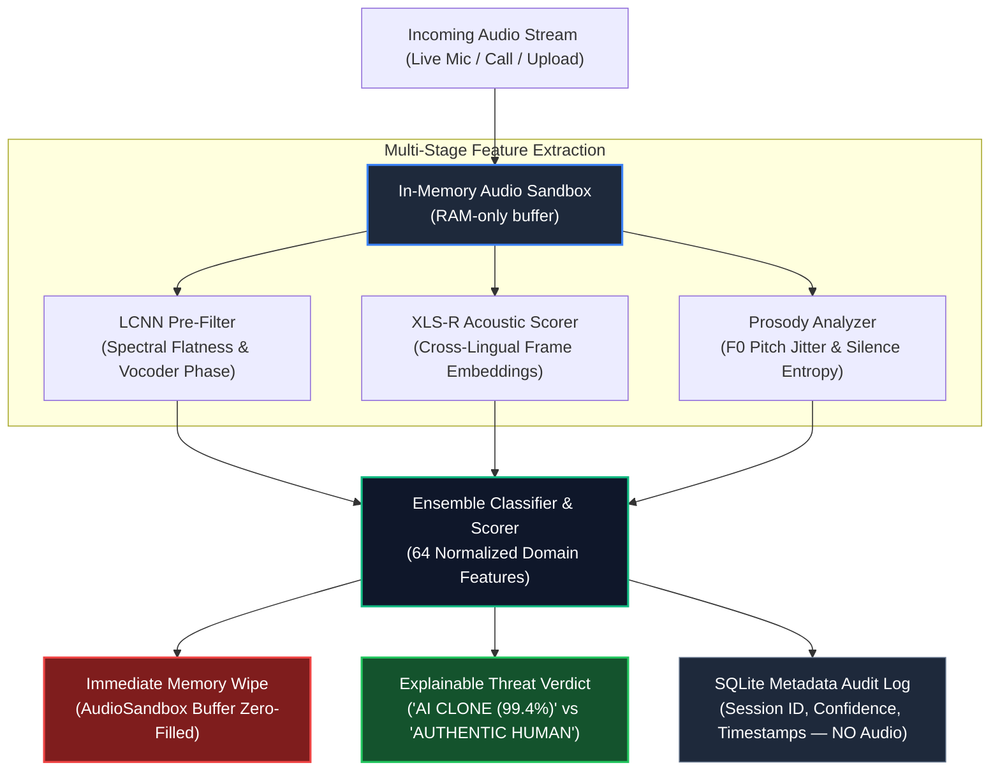

# VoiceGuard India 🇮🇳 (AGENTIS)

> **Privacy-First, Real-Time, On-Device Deepfake Audio Detection for Indic Languages**

[](LICENSE)
[](https://www.python.org/)
[](https://fastapi.tiangolo.com/)
[](#-privacy--dpdp-act-2023-compliance)

---

## 📖 Overview

**VoiceGuard India** (also known as **AGENTIS**) is a real-time, privacy-preserving AI audio deepfake detection system engineered specifically to combat voice-cloning fraud in Indian languages, prioritizing **Hindi (`hi`)** and **Gujarati (`gu`)**.

Voice fraud in telebanking, customer authentication, and support channels is accelerating rapidly due to accessible low-shot Text-to-Speech (TTS) models (e.g., Sarvam AI, IndicSynth, ElevenLabs). Standard English-trained deepfake models fail to catch subtle tonal shifts, micro-tremors, and prosody anomalies unique to Indic dialects. VoiceGuard operates silently during live phone calls or web streams, slicing incoming audio into **2-second rolling chunks**, identifying synthetic audio artifacts within **<500ms latency**, and alerting users before financial or security harm occurs.

---

## ✨ Key Features

- **Indic-First Detection Engine**: Validated on Gujarati and Hindi synthetic speech datasets alongside ASVSpoof benchmarks.
- **Sub-500ms Real-Time Inference**: Supports WebSocket live audio streaming (`ws://`) and FastAPI REST endpoints with sub-500ms processing cycles.
- **Multi-Stage Acoustic Pipeline**:
  - **LCNN Pre-filter**: Evaluates spectral flatness variance and high-frequency vocoder phase artifacts.
  - **Wav2Vec2 / XLS-R Acoustic Scorer**: Analyzes latent cross-lingual frame representations.
  - **Prosody Anomaly Engine**: Measures pitch variance (human micro-tremors vs. synthetic smoothness), jitter, and unvoiced silence ratios.
  - **Ensemble Classifier**: Evaluates 64 domain-invariant acoustic and spectral features.
- **Explainable Threat Telemetry**: Transparent reasoning instead of black-box probabilities (e.g., *"Unnatural pitch regularity & neural vocoder spectral artifacts detected"*).
- **DPDP Act 2023 Compliant**: Architectural privacy enforcement using an in-memory `AudioSandbox` context manager that zero-fills audio memory immediately after scoring.

---

## 🏗️ Repository Architecture

The project has been organized into a unified, modular layout:

```
AGENTIS/
├── backend/                  # Production FastAPI Microservice
│   ├── app/
│   │   ├── audio_ingest/     # WebSocket streaming handlers & session state manager
│   │   ├── audit/            # Metadata-only audit queries & risk statistics
│   │   ├── detection/        # ML feature extractors, acoustic models & ensemble classifiers
│   │   ├── models/           # Pre-trained production classifier weights (*.pkl)
│   │   ├── utils/            # AudioSandbox memory zeroing & PCM decoding utils
│   │   ├── config.py         # Application settings & environment variables
│   │   ├── database.py       # Asynchronous SQLite metadata store (no raw audio)
│   │   └── main.py           # FastAPI application entrypoint & lifespan events
│   ├── tests/                # Automated pytest suite (detection, audit, websockets)
│   ├── Dockerfile            # Production container configuration
│   ├── requirements.txt      # Python dependencies for the backend
│   └── run.py                # Development launcher script
│
├── frontend/                 # Clean, Single-Source Web Interface
│   ├── index.html            # Product landing & marketing platform
│   ├── admin.html            # Audio analyzer, waveform inspector & live microphone tester
│   ├── platform.html         # Platform architecture and specs
│   ├── solutions.html        # Banking, fintech & enterprise security solutions
│   ├── company.html          # Mission & team info
│   ├── pricing.html          # Deployment & API tier pricing
│   ├── contact.html          # Enterprise contact page
│   ├── styles.css            # Unified glassmorphism aesthetic styling
│   ├── main.js               # Navigation & interaction handlers
│   ├── fluid-text.js         # Typography & canvas rendering
│   └── logo.png              # Brand identity assets
│
├── ml/                       # Machine Learning Research & Training
│   ├── engine/               # RF training scripts, dataset studio & SageMaker serve code
│   ├── dataset/              # Sample authentic and cloned Indic audio clips
│   ├── notebooks/            # Research, evaluation & Kaggle/AWS pipeline notebooks
│   ├── ROADMAP.md            # Model roadmap & Indic language expansion plan
│   └── requirements.txt      # Dependencies for ML experimentation & model training
│
├── infra/                    # Cloud Infrastructure & Deployments
│   ├── aws/                  # CloudFront distributions & Elastic Beanstalk configurations
│   ├── ebextensions/         # Elastic Beanstalk system environment hooks
│   └── scripts/              # Cloud bucket provisioning & AWS resource deployment scripts
│
├── assets/                   # Master brand vector graphics and logos
├── _archive/                 # Deprecated legacy prototypes & migration utilities
├── docker-compose.yml        # Multi-service container orchestration
├── .env.example              # Sample environment configuration template
└── .gitignore                # Production ignore rules (preventing DB/venv/cache leaks)
```

---

## 🧠 Technical Pipeline



---

## 🚀 Getting Started

### Prerequisites

- **Python 3.10+**
- **Node.js 18+** & `npm` / `npx`
- **Docker & Docker Compose** (Optional for containerized run)

---

### 1. Backend Service (FastAPI)

```powershell
# Navigate to the backend directory
cd backend

# Activate virtual environment
# Windows PowerShell:
.\venv\Scripts\activate
# Linux/macOS:
source venv/bin/activate

# Install requirements (if not already installed)
pip install -r requirements.txt

# Start the server with hot-reload
uvicorn app.main:app --reload --host 0.0.0.0 --port 8000
```

- **Interactive API Documentation (Swagger)**: [http://localhost:8000/docs](http://localhost:8000/docs)
- **Health Check Endpoint**: [http://localhost:8000/health](http://localhost:8000/health)
- **WebSocket Streaming URL**: `ws://localhost:8000/ws/session/new`

#### Run via Docker Compose:
```bash
docker compose up --build
```

---

### 2. Frontend (Marketing & Live Demo)

```powershell
# Navigate to the frontend directory
cd frontend

# Serve the static files
npx serve .
```

- **Marketing Landing Page**: [http://localhost:3000](http://localhost:3000)
- **Live Detection Dashboard & Mic Test**: [http://localhost:3000/admin.html](http://localhost:3000/admin.html)

---

### 3. ML Training & Experimentation

```powershell
# Navigate to ML directory
cd ml

# Activate environment
.\venv\Scripts\activate
pip install -r requirements.txt

# Train the Random Forest Classifier on extracted features
python engine/train_real_rf_model.py

# Launch Feature Extraction Studio
python engine/dataset_studio.py
```

---

## 🔌 API & WebSocket Protocol

### 1. REST Detection (`POST /api/detect`)

Send an audio file directly for instant classification:

```bash
curl -X POST "http://localhost:8000/api/detect?language=hi" \
     -F "file=@sample.wav"
```

**Response:**
```json
{
  "is_deepfake": true,
  "confidence_score": 99.46,
  "language": "hi",
  "explainability": {
    "reason": "Spectral MFCC delta patterns and energy distribution match neural TTS vocoder artifacts.",
    "highlight_segments": [{ "start": 0.5, "end": 1.5 }],
    "stage_breakdown": {
      "mfcc_artifacts": 99.0,
      "spectral_centroid": 99.46,
      "zero_crossing_rate": 95.0
    }
  },
  "processing_time_ms": 150.0
}
```

---

### 2. Streaming WebSocket (`/ws/session/{session_id}`)

Connect to: `ws://localhost:8000/ws/session/new`

**Step 1 — Initial Handshake:**
```json
{
  "language": "hi"
}
```

**Step 2 — Stream Rolling Chunks (Base64 PCM, 16kHz, 16-bit Mono):**
```json
{
  "chunk_id": 1,
  "audio_b64": "<base64_pcm_data>",
  "language": "hi",
  "sample_rate": 16000
}
```

**Step 3 — Receive Real-Time Telemetry:**
```json
{
  "chunk_id": 1,
  "score": 88,
  "language": "hi",
  "processing_ms": 220,
  "verdict_so_far": "CRITICAL"
}
```

**Step 4 — End Call Session:**
```json
{
  "action": "end_session"
}
```

---

## 🔒 Privacy & DPDP Act 2023 Compliance

VoiceGuard India is engineered around **Privacy by Architecture**:

- **Zero Disk Audio Persistence**: Raw audio buffers are strictly stored in RAM within the `AudioSandbox` context manager and explicitly zero-filled (`audio.fill(0)`) immediately following inference.
- **Metadata-Only Auditing**: The SQLite audit database records timestamps, numerical threat confidence scores, and language codes. No audio recordings, transcripts, or personal identifiers are stored.
- **On-Device / Local Edge Compute**: Audio remains within local boundary networks without transmitting raw caller voices to foreign third-party cloud APIs.

---

## 🛠️ Technology Stack

| Layer | Technologies |
|---|---|
| **Backend API & WebSockets** | Python 3.10+, FastAPI, Starlette, WebSockets, Uvicorn, aiosqlite |
| **Audio Processing & Signal Analysis** | Librosa, NumPy, SciPy, SoundFile, PyTorch, Transformers (XLS-R) |
| **Machine Learning** | Scikit-Learn (Random Forest, SVM), XGBoost, Joblib |
| **Frontend & Visualization** | HTML5, CSS3, Modern JavaScript (ES6+), WaveSurfer.js |
| **Cloud & Deployment** | Docker, Docker Compose, AWS Elastic Beanstalk, CloudFront |
| **Compliance & Security** | DPDP Act 2023 Principles, In-Memory Memory Sanitization |

---

## 📜 License

This project is licensed under the **MIT License** — see the [LICENSE](LICENSE) file for details.
